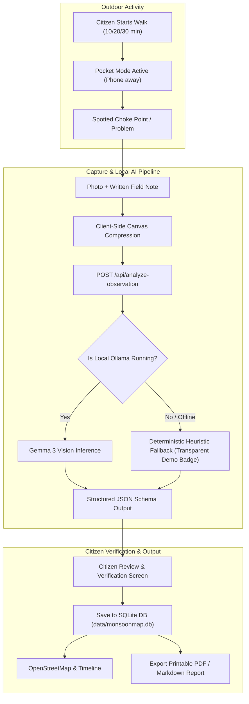

# MonsoonMap

> **Walk your streets. Expose the problems. Make the evidence count.**  
> Built for the **Hacktoberfest x DEV Week 1 “Touch Grass” Challenge**.

[](https://github.com/jyothikacodes/monsoonmap/actions/workflows/ci.yml)
[](https://monsoonmap.vercel.app)
[](LICENSE)

🌐 **Live Deployed Web Application**: [**https://monsoonmap.vercel.app**](https://monsoonmap.vercel.app)

MonsoonMap encourages people to spend time outdoors observing their surroundings and documenting environmental and infrastructure problems—particularly after rainfall.

During a short outdoor observation walk, citizens document waterlogging, choked stormwater drains, accumulated runoff litter, and damaged footpaths. MonsoonMap uses an open-weight vision-language model (**Gemma 3 Vision** via Ollama) to turn raw field observations into structured, human-reviewable civic evidence reports.

Designed from the ground up for **pocket carry**: the interface encourages users to put their phones away between observations, never rewarding continuous screen time.

---

## 🏛️ Why MonsoonMap? The "Touch Grass" Civic Mission

When heavy rains hit a neighborhood, ordinary sidewalks transform into obstacle courses. Submerged curb ramps force wheelchair users and parents with strollers into vehicular traffic lanes; plastic litter chokes storm grates; dislodged pavers squirt muddy water underfoot.

Yet municipal response is often hindered by vague complaints (*"the street is flooded"*). MonsoonMap gives walking citizens a disciplined tool to:
1. **Get outdoors**: Take a 10, 20, or 30-minute observation walk.
2. **Observe reality**: Spot physical impediments with a contextual checklist.
3. **Structure evidence**: Use open-weight vision AI to separate directly visible physical facts from assumptions about causes or severity.
4. **Retain human control**: Review, correct, and verify every report before saving.
5. **Generate shareable evidence**: Export clean, printable PDF documents or copyable markdown reports for ward committees and neighborhood assemblies.

---

## 🌟 Key Features

### 1. Outdoor Walk Mode
- **Configurable Walk Durations**: 10, 20, or 30-minute target sessions.
- **Contextual Observation Foci**: Rainfall & waterlogging, drainage grates, footpath safety, litter & runoff waste, or general neighborhood conditions.
- **Contextual Checklists**: Gentle field prompts reminding walkers what physical signs to look for.
- **Pocket Mode**: Screen-dimming heads-up mode that keeps the elapsed timer running while prompting users to keep their phones in their pocket until they stop to observe.
- **Resilient Persistence**: Walk sessions and elapsed times persist across page refreshes and browser tabs using `localStorage`.
- **Optional, Permission-Based Geolocation**: Geolocation is never mandatory. Users can capture GPS coordinates or enter manual cross-streets.

### 2. Observation Capture & Compression
- **Camera & File Capture**: Supports native device camera (`capture="environment"`) or gallery uploads.
- **Client-Side Canvas Compression**: High-resolution smartphone camera photos (8–15 MB) are automatically compressed on-device down to ~150–250 KB WebP/JPEG before transmission.
- **6 Issue Categories**:
  - `waterlogging`: Waterlogging & standing water pools
  - `blocked_drainage`: Blocked or broken storm drain grates
  - `litter`: Accumulated runoff litter and solid waste
  - `damaged_footpath`: Cracked pavers, potholes, and washed-out sidewalks
  - `unsafe_crossing`: Flooded crosswalks and submerged curb ramps
  - `other`: Unclassified physical neighborhood obstacles

### 3. Open-Source AI Analysis (Gemma 3 Vision)
- **Local Open-Weight Inference**: Configured to connect to a local **Ollama** runtime running `gemma3:4b-instruct` (or `llava`/`paligemma`).
- **Disciplined Evidence Separation**: Prompts strictly instruct the model to separate visible physical facts from assumptions about subterranean pipe causes or flood depth.
- **Validated JSON Schema**:
  - `suggestedCategory`: Categorization based on visual evidence
  - `evidenceSummary`: Concise physical evidence description
  - `observableSeverityIndicators`: Array of concrete visual markers (e.g., *"Standing water extends across 100% of walkable path"*)
  - `severityLevel`: `low` | `medium` | `high` | `unverified`
  - `confidenceScore` & `confidenceRationale`
  - `suggestedFollowups`: Concrete follow-up checks (e.g., *"Check if puddle drains within 3 hours"*)
  - `questionsForHumanVerifier`: Prompts for the walking citizen to confirm
- **Transparent Demo Fallback Mode**: If the local model runtime is unreachable, the system does not fail or fake results. It transparently falls back to deterministic heuristic parsing with a clearly visible badge: `Gemma 3 Vision (Offline Demo Fallback)`.

### 4. Human-in-the-Loop Review & Civic Export
- **100% Editable**: Walkers can alter categories, edit AI descriptions, and add field notes before approving.
- **Print / PDF Report Export**: Clean `@media print` styling generates professional evidence documents suitable for civic meetings.
- **Formatted Markdown Export**: Single-click copy of formatted markdown reports for emails or community chat groups.
- **Hotspot & Proximity Detection**: Automatically alerts the user if another observation was recorded within 150 meters.

### 5. OpenStreetMap & Timeline
- **Leaflet Map Integration**: Dynamic client-rendered map using OpenStreetMap humanitarian tiles.
- **Custom Category Markers**: Color-coded SVG markers showing issue types.
- **Synchronized Timeline**: Filter by category, search by street keywords, and inspect detailed records.
- **Separated Demo Samples**: Pre-seeded reference records are explicitly labeled with a `[Demo]` tag and can be toggled on/off.

### 6. Privacy & Field Safety
- **Private by Default**: Data is stored locally in the application database (`data/monsoonmap.db`) and browser storage.
- **Non-Surveillance Guarantee**: The AI does not process facial biometrics or license plate numbers.
- **Safety First**: Clear warnings reminding users never to wade into floodwaters, approach fallen power lines, or step into vehicular traffic.

---

## 🏗️ Architecture & Data Flow



---

## 🛠️ Technology Stack

| Layer | Technologies |
|---|---|
| **Framework** | Next.js 16 (App Router, Turbopack, React 19) |
| **Styling** | Tailwind CSS v4, Newsreader / Plus Jakarta Sans fonts |
| **Mapping** | Leaflet 1.9, OpenStreetMap Humanitarian Tiles |
| **Database** | Node.js Built-in SQLite (`node:sqlite`), LocalStorage client sync |
| **Open-Source AI** | Ollama local API, Google Gemma 3 Vision (`gemma3:4b-instruct`) |
| **Icons** | Lucide React |

---

## 🚀 Quickstart & Local Setup

### Prerequisites
- Node.js `v22.0.0` or later (tested on Node `v26.8.1`).
- Optional: [Ollama](https://ollama.com/) if running live local AI inference.

### 1. Clone & Install
```bash
cd monsoonmap
npm install
```

### 2. Configure Environment Variables (Optional)
Create a `.env.local` file in the `monsoonmap` directory if you wish to customize Ollama endpoints:

```bash
# Default Ollama local endpoint
OLLAMA_BASE_URL=http://127.0.0.1:11434

# Vision model of your choice
OLLAMA_MODEL=gemma3:4b-instruct

# Inference timeout (ms)
AI_TIMEOUT_MS=25000
```

### 3. Setting Up Local Gemma 3 Vision (Optional for Live Inference)
If you want live open-weight vision model inference instead of the built-in demo fallback mode:

```bash
# Start Ollama server
ollama serve

# In another terminal, pull the Gemma 3 vision model
ollama pull gemma3:4b-instruct
```

> **Note:** If Ollama is not running, MonsoonMap runs in **Demo Fallback Mode** with deterministic heuristics. Every feature (walk mode, checklists, review, mapping, reports) functions completely offline without requiring Ollama.

### 4. Run the Application
```bash
npm run dev
# Or for optimized production build:
npm run build && npm run start
```
The application will be live at: **`http://localhost:3005`**

---

## 🧪 Running Automated Tests

MonsoonMap includes an automated verification test suite testing SQLite persistence, category definitions, Haversine proximity formulas, deterministic fallback schemas, and markdown report formatting:

```bash
npm test
```

Expected output:
```text
🧪 Starting MonsoonMap Automated Verification Suite...

  ✅ PASS: SQLite schema initialization and CRUD
  ✅ PASS: Category definitions and color assignments
  ✅ PASS: Haversine distance formula accuracy
  ✅ PASS: Deterministic AI fallback generates valid schema
  ✅ PASS: Markdown report formatting generates complete evidence document

========================================
Test Results: 5 Passed, 0 Failed
========================================
```

---

## 🔒 Privacy, Safety & Legal Disclaimers

1. **Non-Affiliation**: MonsoonMap is an independent, community-driven civic tech project created by residents. It is not an official municipal dispatch system or government hotline.
2. **Personal Safety**: Users are repeatedly instructed to observe from safe ground, never wade into floodwaters, and never touch downed power lines.
3. **Data Ownership**: Observation records remain stored in your local application database. We do not track users or sell data.

---

## 📄 License

This project is licensed under the [MIT License](LICENSE).
